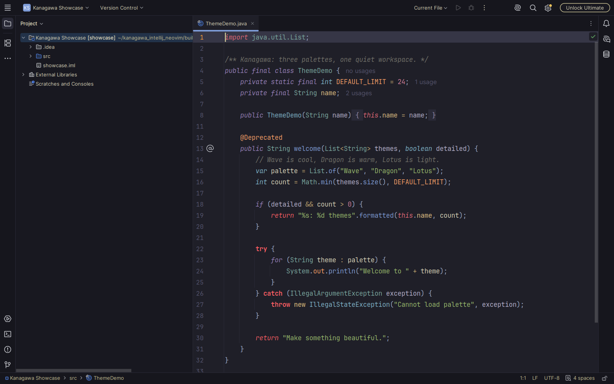
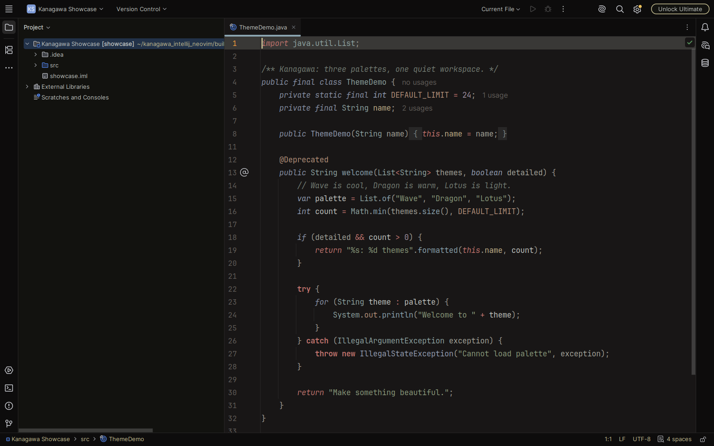
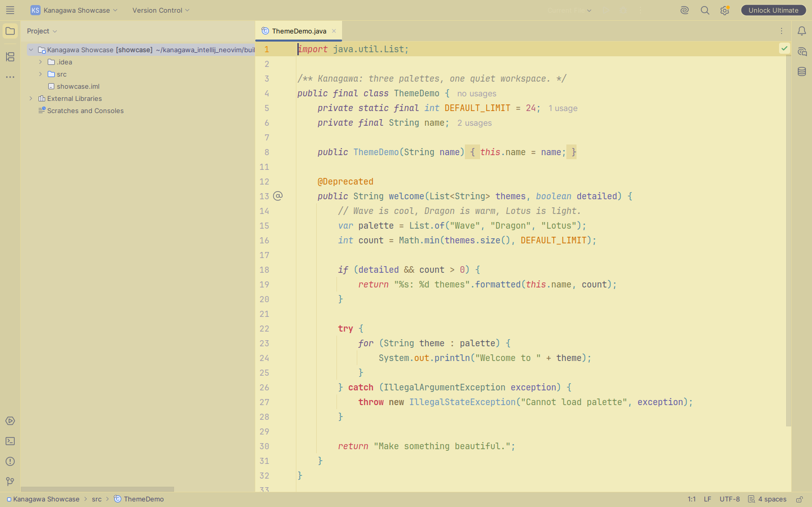

# Kanagawa Neovim Port

**Wave, Dragon and Lotus in one IntelliJ theme plugin.**

A port of [kanagawa.nvim](https://github.com/rebelot/kanagawa.nvim), keeping its
original palette and highlight styles while using dimmed UI surfaces for a
quieter workspace. Includes editor colors, tool windows, dialogs, Git/diffs,
diagnostics, terminal colors, and extra Java highlighting for Neovim-style
keyword distinctions.

Requires IntelliJ Platform **2026.2 or newer**. Other languages use the color
scheme keys supplied by their IntelliJ language plugins; their token categories
can differ from Neovim's.

### Wave



### Dragon



### Lotus



## Manual installation

1. Download **kanagawa-neovim-port-1.1.0.zip** from
   [GitHub Releases](https://github.com/Somed-1/kanagawa-intellij-nvim-port/releases).
2. Open **Settings → Plugins → ⚙ → Install Plugin from Disk** and select the ZIP.
3. Restart the IDE.
4. Open **Settings → Appearance & Behavior → Appearance → Theme** and choose
   **Kanagawa Wave (Neovim)**, **Kanagawa Dragon (Neovim)**, or **Kanagawa Lotus (Neovim)**.
   The corresponding editor scheme is selected with the theme; it is also
   available under **Editor → Color Scheme**.

JetBrains Marketplace publication is planned. Until a listing is available,
use the manual installation above.

## Credits

- [rebelot/kanagawa.nvim](https://github.com/rebelot/kanagawa.nvim) by **Tommaso
  Laurenzi** — the original themes, palettes and highlight definitions.
- [frykher/jetbrains-kanagawa-theme](https://github.com/frykher/jetbrains-kanagawa-theme)
  by **Fahim H.** — the earlier IntelliJ Kanagawa plugin, acknowledged for its
  work bringing Kanagawa to JetBrains IDEs and as a useful reference.
- JetBrains' IntelliJ Platform theme definitions and nvim-treesitter's Java
  queries informed the platform and token mappings. See
  [third-party notices](THIRD_PARTY_NOTICES.md) for licenses.

## AI usage

This project was developed with **OpenAI Codex** assistance, including theme
mappings, Java highlighting, build scripts, tests and documentation. Palette
and highlight values come from the original Kanagawa source.

## Build

With Python 3 and a local IntelliJ IDEA 2026.2+ installation:

```sh
export INTELLIJ_HOME=/path/to/intellij-idea
make test
python3 scripts/check_runtime.py --ide "$INTELLIJ_HOME"
```

The installable plugin ZIP is written to `dist/`. See
[development notes](docs/DEVELOPMENT.md) for source provenance, screenshots and
local installation.

## License

[MIT](LICENSE). Original Kanagawa assets retain their MIT attribution; bundled
IntelliJ references and Java query references retain their Apache 2.0 notices.
